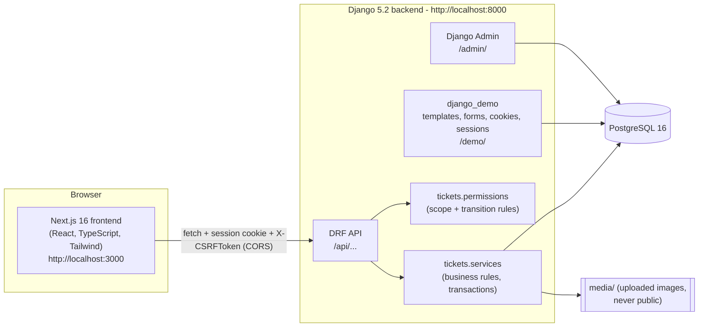
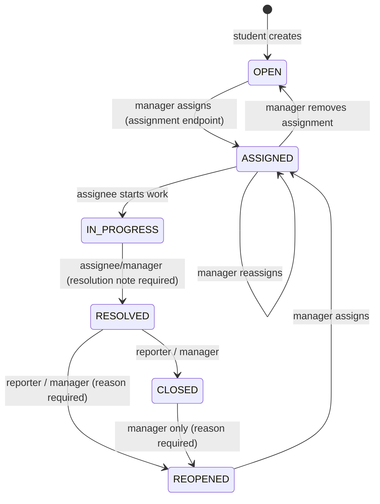
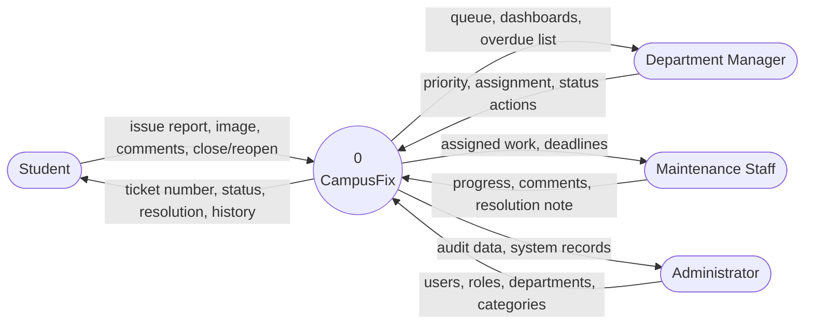
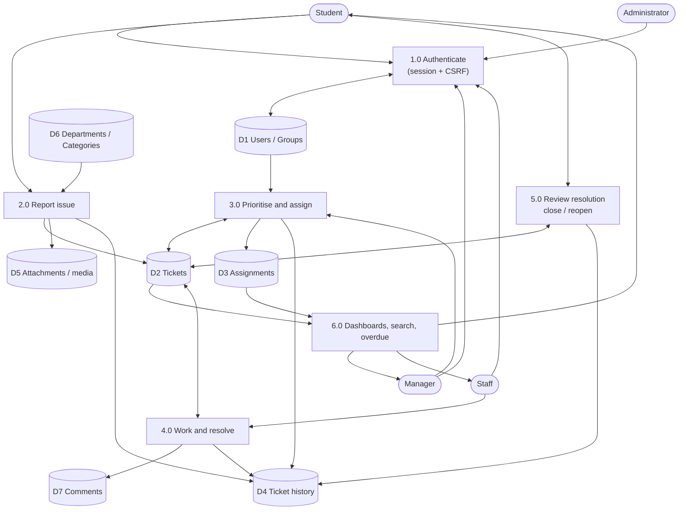

# CampusFix - Architecture

## 1. Components



| Component | Responsibility |
|---|---|
| **Next.js frontend** | Pages, forms, validation for convenience, role-based navigation, loading/error/empty states. Holds **no** secrets and makes **no** authorization decisions that the server does not repeat. |
| **`accounts`** | Custom `User` (email login, role, department), session login/logout/me/CSRF endpoints, role-to-Group synchronisation (`services.py`), eligible-staff endpoint. |
| **`departments`** | `Department`, `Category` (category -> department routing), read-only reference endpoints. |
| **`tickets`** | `Ticket`, `Assignment`, `Comment`, `TicketHistory`, `Attachment`; `permissions.py` (visibility scope + transition table), `services.py` (create/assign/status/priority/comment/attachment inside transactions), filters, pagination, admin. |
| **`dashboard`** | Role-scoped summary, category counts, overdue list (ORM aggregates). |
| **`django_demo`** | Server-rendered syllabus demonstration area (INT 253 Units II-IV, VI). |
| **PostgreSQL** | System of record; enforces FKs, unique ticket numbers, and *one active assignment per ticket*. |

## 2. Layering inside the backend

```text
HTTP request -> URL -> DRF view/viewset -> serializer (input validation)
                                  |-> permissions.visible_tickets_for(user)   (data scope; 404 outside scope)
                                  |-> services.<operation>()                  (transaction + row lock + rule checks
                                  |                                            + history record in same transaction)
                                  `-> serializer (output)  -> JSON
```

Key rule: **every ticket query starts from `visible_tickets_for(user)`**, so a ticket outside the
caller's scope returns **404** on the detail route and on every sub-resource
(`/history/`, `/comments/`, `/attachments/<id>/` ...). Existence is never revealed.

## 3. Authentication, session and CSRF flow

```mermaid
sequenceDiagram
    participant B as Browser (localhost:3000)
    participant D as Django (localhost:8000)
    B->>D: GET /api/auth/csrf/  (credentials: include)
    D-->>B: Set-Cookie csrftoken + JSON {csrfToken}
    B->>D: POST /api/auth/login/ {email,password} + X-CSRFToken
    D-->>B: 200 user JSON + Set-Cookie sessionid (HttpOnly, SameSite=Lax); CSRF token rotates
    B->>D: GET /api/auth/me/  (cookie sent automatically)
    D-->>B: {id, email, role, department}
    B->>D: POST /api/tickets/ + X-CSRFToken (+ cookie)
    D-->>B: 201 ticket
    B->>D: POST /api/auth/logout/ + X-CSRFToken
    D-->>B: 204 (session destroyed)
```

* Session cookie is **HttpOnly** - JavaScript can never read it. No tokens in `localStorage`.
* All unsafe methods (POST/PATCH) require the `X-CSRFToken` header. The login view enforces CSRF explicitly
  (`csrf_protect`), because DRF only checks CSRF for already-authenticated sessions.
* CORS: exactly one allowed origin (`FRONTEND_ORIGIN`), `Access-Control-Allow-Credentials: true`, no wildcard.
* Unauthenticated -> **401**; authenticated but forbidden -> **403**; outside scope -> **404**;
  invalid transition -> **409**; invalid input -> **400**.

## 4. Ticket state machine



Reassigning a ticket that is `IN_PROGRESS` returns it to `ASSIGNED` for the new person (documented decision).
Administrators may perform any permitted transition. Anything not drawn is rejected with **409**.

## 5. Data flow diagrams

### 5.1 DFD Level 0 (context)



### 5.2 DFD Level 1



## 6. Security measures implemented

Server-side authorization on every endpoint; object-level scope; server-derived reporter and department;
ORM only (no raw SQL); DRF serializer validation; upload size + real-image (Pillow) check + generated
file names + `X-Content-Type-Options: nosniff`; uploads served only through a permission-checked endpoint;
generic login errors (no account enumeration) and login rate limit; HttpOnly + SameSite session cookie;
CSRF on unsafe requests; strict CORS; secrets only in environment variables; append-only history;
`PROTECT` foreign keys so referenced users/departments/categories cannot be hard-deleted.
