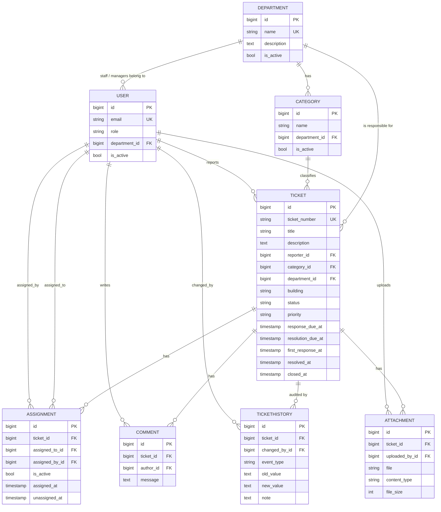

# CampusFix - Database Design (PostgreSQL)

## 1. ER diagram

(Django's built-in `auth_group`, `auth_permission`, `django_session`, `django_admin_log` tables are also present.)

## 2. Entities

| Table | Purpose | Notable columns |
|---|---|---|
| `accounts_user` | Custom user. Login = e-mail (unique, stored lower-case). | `role` (STUDENT, MAINTENANCE_STAFF, DEPARTMENT_MANAGER, ADMINISTRATOR), `department_id` (null for students/admins), `is_active` |
| `departments_department` | Responsible department | `name` unique, `is_active` |
| `departments_category` | Issue type -> department | unique (`department`,`name`), `is_active` |
| `tickets_ticket` | The issue | `ticket_number` unique `CF-YYYY-NNNNNN`; `status`, `priority`; SLA fields; `resolution_note`; `sla_started_at` |
| `tickets_assignment` | Assignment *history* | `is_active`, `unassigned_at`; previous rows are kept on reassignment |
| `tickets_comment` | Append-only communication record | `message` |
| `tickets_tickethistory` | Append-only audit trail | `event_type` (CREATED, STATUS, PRIORITY, ASSIGNMENT, DEADLINE, ATTACHMENT), `old_value`, `new_value`, `note` |
| `tickets_attachment` | Uploaded image metadata | `file` (generated key), `original_filename`, `content_type`, `file_size` |

## 3. Constraints and integrity

| Rule | Where enforced |
|---|---|
| Unique e-mail, department name, ticket number | `UNIQUE` constraints |
| Category name unique within a department | `unique_category_name_per_department` |
| **At most one active assignment per ticket** | PostgreSQL **partial unique index** `one_active_assignment_per_ticket` (`UNIQUE (ticket_id) WHERE is_active`) |
| Referenced user/department/category cannot be hard-deleted | `on_delete=PROTECT` on reporter, assignee, author, history actor, uploader, category, department |
| Ticket child rows follow the ticket | `on_delete=CASCADE` from `Ticket` (tickets themselves cannot be deleted in Django Admin) |
| History cannot be edited | `TicketHistory.save()` rejects updates; admin has no add/change/delete |
| Valid status / priority | `choices` + serializer `ChoiceField` |
| Concurrent updates | `select_for_update()` on the ticket row inside `transaction.atomic()` |

## 4. Indexes

`ticket_status_idx (status)`, `ticket_priority_idx (priority)`, `ticket_created_idx (created_at)`,
`ticket_dept_status_idx (department, status)`, `ticket_reporter_idx (reporter)`, plus the automatic
primary-key / unique / foreign-key indexes.

## 5. Notes on the design

* `Ticket.department` is **derived from the category** when the ticket is created (never taken from the client).
* **Ticket numbers** are derived from the primary key (`CF-<year>-<pk, 6 digits>`) inside the creating transaction,
  so they are unique (gaps are possible if a transaction is rolled back). The sequence does not restart each year (documented decision).
* **Overdue** is computed, not stored: an active (not Resolved/Closed) ticket is overdue if the resolution deadline passed,
  or the response deadline passed with no first response.
* `Ticket.sla_started_at` (not in the original field list) is the clock start: creation, or the latest reopening.
* `Ticket.resolution_note` (not in the original field list) stores the resolution details the student reviews.
